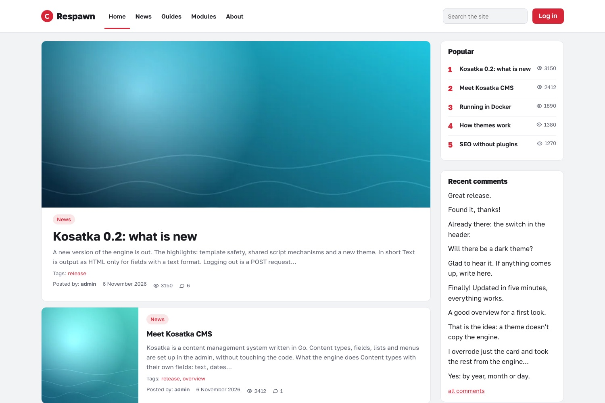
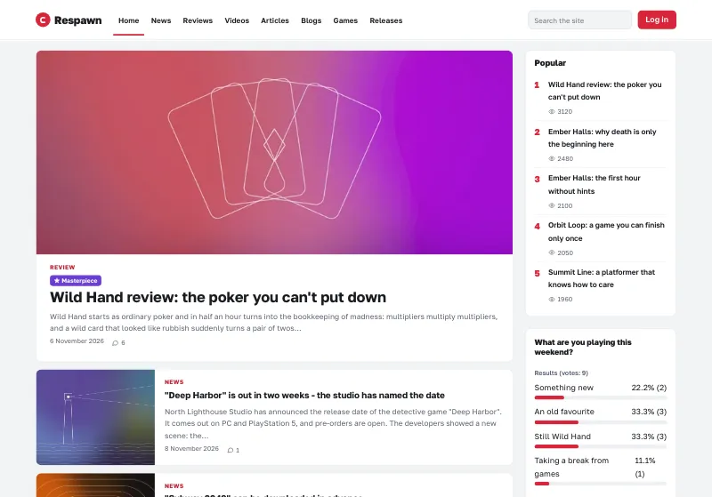
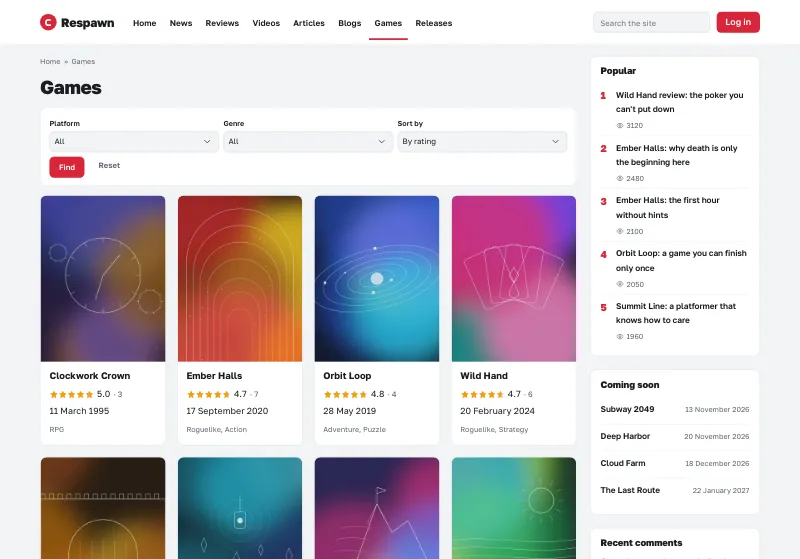
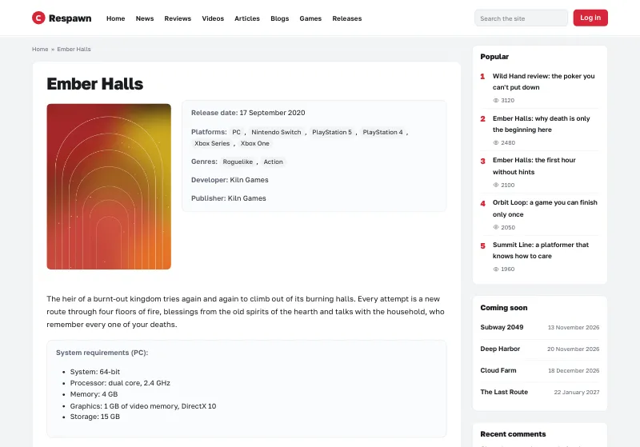
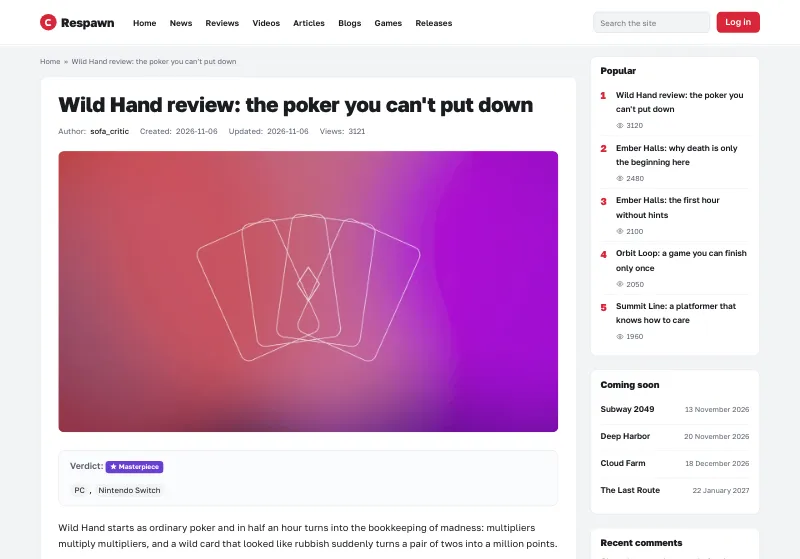
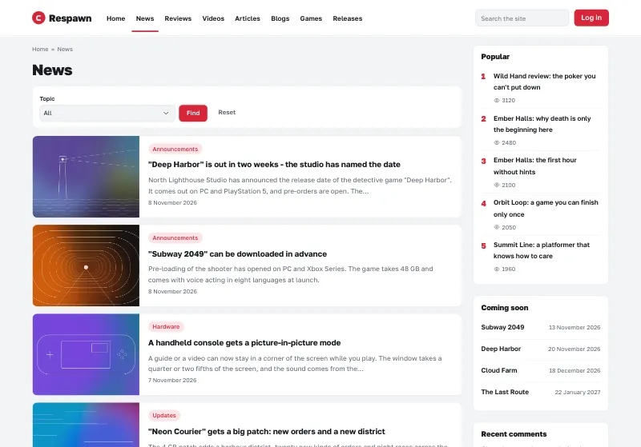
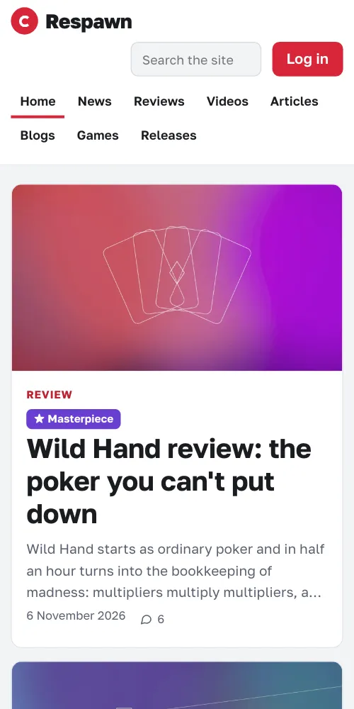
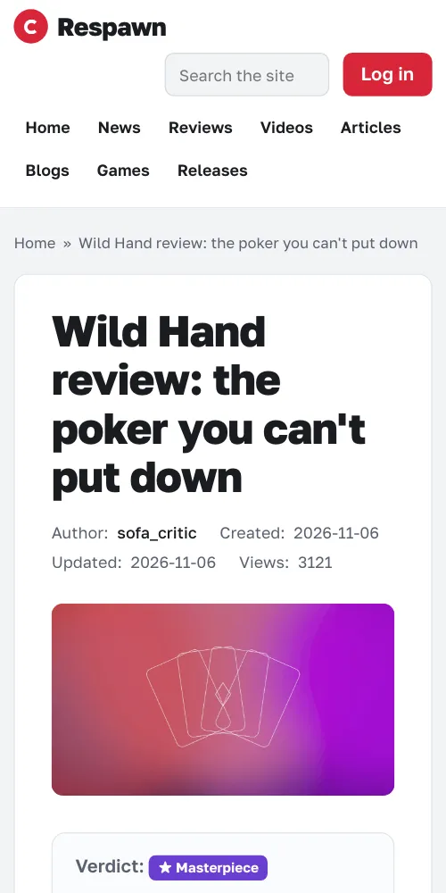

# Respawn

A theme for [Kosatka](https://github.com/kosatka-cms/kosatka): a light
portal of news and reviews - a white header with the main menu and a
search, cards on light grey, a front page that leads with its first item,
a dark footer, one accent colour. A list field's options show as coloured
badges in their order (a review's verdict, a difficulty), so it suits a
site of ratings and reviews.



## Screenshots

The [demo site](#a-demo-site); a picture opens the whole page.

<table>
  <tr>
    <td width="50%"><a href="docs/screenshots/home.webp"></a><br>The front page</td>
    <td width="50%"><a href="docs/screenshots/games.webp"></a><br>The games, with their filters and ratings</td>
  </tr>
  <tr>
    <td><a href="docs/screenshots/game.webp"></a><br>A game and what is written about it</td>
    <td><a href="docs/screenshots/review.webp"></a><br>A review with its verdict</td>
  </tr>
  <tr>
    <td><a href="docs/screenshots/news.webp"></a><br>The news</td>
    <td><a href="docs/screenshots/phone-home.webp"></a> <a href="docs/screenshots/phone-review.webp"></a><br>On a phone: the front page, a review</td>
  </tr>
</table>

## Install

```bash
app theme add https://github.com/kosatka-cms/kosatka-theme-respawn
```

Then commit `themes/` and choose *Respawn* on *Appearance*. See
[Distributing a theme](https://kosatka-cms.github.io/kosatka/themes/distribute/).

More themes for Kosatka: the [themes catalog](https://github.com/kosatka-cms/themes).

## A demo site

The theme comes with a demo site, in English (`demo/en.yaml`) and in
Russian (`demo/ru.yaml`): a game portal with news, reviews, videos,
articles, players' blogs, game pages with ratings, a release calendar,
a poll and a forum. Everything in it is made up - the games, the
studios, the news and the people; its pictures are abstract, drawn for
it, and come with the theme (`demo/images`). On a new site (Kosatka 0.1.6
or newer):

```bash
app install -site-name "Respawn" -admin-name admin -admin-email admin@example.com \
  -language en -demo-set respawn
```

The forum's part needs a site built with the
[forum module](https://github.com/kosatka-cms/kosatka-module-forum);
without it the site is installed without the forum. Everything the demo
creates is ordinary content, Views and blocks, changed or deleted in the
admin.

The screenshots above are of it: `python3 scripts/screenshots.py
http://127.0.0.1:8080` (the demo site's address) takes them again into
`docs/screenshots/` - Python 3 and Google Chrome are all it needs.

## Settings

On *Appearance → Respawn → Settings*:

| Setting | Default |
|---|---|
| Accent colour | `#d72638` |
| The header's mark - the theme's ring or the site's logo | the ring |
| A search in the header | on |

## Regions

The engine's regions - *Header*, *Sidebar*, *Content top*, *Content
bottom*, *Inside content*, *Footer*, *Footer bottom line* - so blocks
placed for another theme stay where they are. A new site gets the
copyright block (on the left) and a "Powered by Kosatka CMS" block (on
the right) in *Footer bottom line*; both are ordinary blocks to change
or remove on *Blocks*.

## Fonts

Golos Text, with Latin and Cyrillic. It comes with the theme
(`static/fonts`, SIL Open Font License 1.1) and the site serves it: no
requests to other servers.

## Translations

The theme's own strings: English, Russian, German and Spanish
(`translations/`).

## License

MIT
